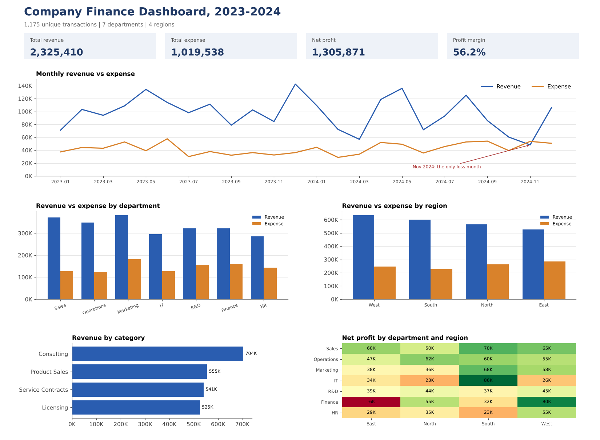

# Company Finance Analysis: Why Did 2024 Revenue Fall?

SQL, Python and Excel analysis of 1,175 finance transactions (2023-2024) across 7 departments and 4 regions, with an interactive web dashboard and Power BI build files.



**Interactive dashboard:** [open the live version](https://nishantsharmabtech24-28.github.io/finance-transactions-analysis/) (filters by year, region and department; works on a phone). The same file is in [`docs/index.html`](docs/index.html).

## Business question

The company is profitable, but revenue fell in 2024 while costs rose. **Where is the money being made and lost, what caused the change, and what should management do about it?**

## Answer in brief

- The company earned **2.33M revenue against 1.02M expenses (56% margin)**.
- In 2024, revenue fell **13%** and expenses rose **13%**, so net profit dropped **29%** (763K to 543K).
- The cause is **volume, not price**: revenue transactions fell 15% (272 to 232) while the average deal size rose 2%.
- The fall is concentrated in **Product Sales (-25%), Licensing (-18%), the East (-26%) and West (-19%) regions, and the Sales and R&D departments (-26% each)**.
- Costs rose mainly in **Marketing Spend (+31K), Utilities (+25K) and Software (+25K)**.
- **Caution:** with only 12 months per year, the revenue decline is **not statistically significant** (Welch t-test p = 0.21). It is a warning sign to monitor, not a proven trend.

## Key numbers

| Metric | Value |
| --- | --- |
| Total revenue | 2,325,410 |
| Total expense | 1,019,538 |
| Net profit | 1,305,871 |
| Profit margin | 56.2% |
| Best region by margin | South (62%) |
| Weakest region by margin | East (46%) |
| Most efficient department | Sales (66% margin) |
| Only loss-making month | Nov 2024 (-5.4K) |
| Only loss-making department-region pair | Finance-East (-5.6K) |

## Recommendations

| Action | Evidence |
| --- | --- |
| Investigate the 2024 deal-volume drop in Product Sales and Licensing | These two categories account for 130K of the 160K revenue decline |
| Review the East and West regions | East revenue -26%, West -19%; East has the lowest margin (46%) |
| Review Marketing spend against the revenue it brings | Highest expense (181K) but only a 52% margin; Marketing Spend rose 31K in 2024 |
| Fix the Finance-East cost structure | Only loss-making pair: expenses 50.9K vs revenue 45.3K |
| Plan budgets around seasonality | Revenue peaks in May and December; Nov 2024 was a loss month |

## How this was done

1. **Cleaned the data with SQL.** Removed 15 exact duplicates (1,190 to 1,175 rows), standardized department names (`hr` to HR) and trimmed spaces in region values. No missing values, negative amounts or invalid dates were found.
2. **Analysed with SQL.** 11 queries: monthly trend, region and department profitability, categories, year over year, loss-making months and largest transactions.
3. **Investigated causes with Python.** pandas analysis of volume vs value, drivers by category, region and department, a significance test, an outlier check and a margin heatmap. It also checks that the pandas cleaning matches the SQL result.
4. **Built dashboards.** An interactive web dashboard (HTML and JavaScript, three pages with filters), a formula-driven Excel dashboard, and a Power BI data model with DAX measures and a build guide.

## Skills shown

- **SQL:** views, CASE expressions, aggregation, data cleaning
- **Python:** pandas, matplotlib, SciPy (Welch t-test, Mann-Whitney)
- **Excel:** formula-driven dashboard with charts and a heatmap
- **Dashboards:** interactive HTML/JavaScript dashboard, Excel dashboard, Power BI star-schema model and DAX measures (the `.pbix` file is not included)
- **Communication:** findings written as a business question, answer and recommendations

## Data

| Column | Description |
| --- | --- |
| transaction_id | Transaction identifier |
| date | Transaction date (2023-01-01 to 2024-12-31) |
| department | Marketing, Finance, R&D, HR, IT, Sales, Operations |
| region | North, South, East, West |
| type | Revenue or Expense |
| category | Consulting, Licensing, Software, Salaries, and so on |
| amount | Transaction amount |

Source: [WRITE YOUR DATA SOURCE HERE, for example a course dataset, Kaggle or a practice dataset].

## Repository structure

```
data/raw/        original CSV and SQLite database
data/cleaned/    cleaned CSV (1,175 rows)
sql/             queries and their result files
python/          pandas analysis notebook, script, charts
powerbi/         data model tables, DAX measures, theme, build guide
docs/            interactive web dashboard (index.html)
dashboard/       Excel dashboard and screenshots
report/          full findings and recommendations
```

## How to reproduce

**SQL:** open `data/raw/finance_project.db` in DB Browser for SQLite and run `sql/finance_queries.sql` (run the `CREATE VIEW` statement first).

**Python:**

```bash
cd python
pip install -r requirements.txt
python finance_analysis.py
```

The notebook `python/finance_analysis.ipynb` contains the same analysis with outputs.

**Interactive dashboard:** open `docs/index.html` in any browser.

**Power BI:** follow `powerbi/BUILD_GUIDE.md`.

Full write-up with tables: [report/findings.md](report/findings.md).

## Limitations

- Two years and 1,175 transactions: seasonal patterns are indicative, not proven.
- Shared or allocated costs are not visible, so department margins are based on the labelled transactions only.
- The analysis shows what happened and where, not why. Causes need business context such as pricing, headcount or campaigns.

## Author

Nishant, B.Tech student, LIET. [WRITE YOUR LINKEDIN LINK HERE]
